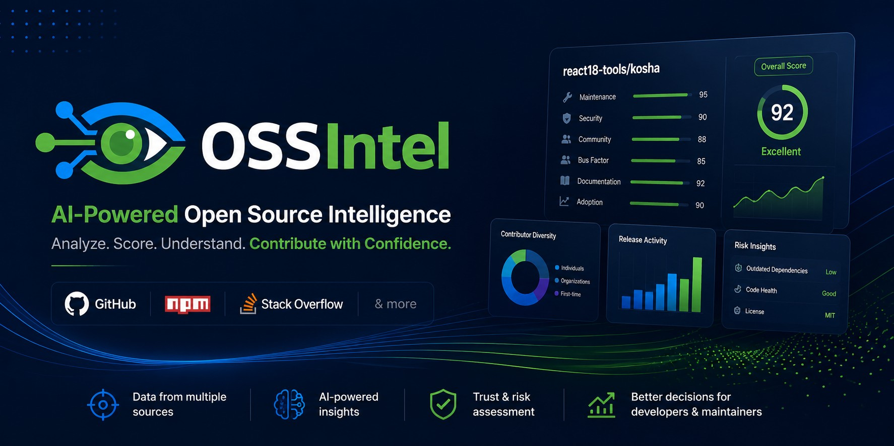

# OSSIntel

[](https://ossintel.js.org/repo/ossintel/ossintel)
[](https://github.com/apps/ossintel)



> Open Source Intelligence Platform

OSSIntel transforms GitHub profiles, repositories, and npm packages into actionable insights.

Unlike GitHub, which primarily shows activity, OSSIntel helps answer questions such as:

- Is this project healthy?
- Can I trust this package?
- How impactful is this maintainer?
- What are the biggest risks?
- Where should contributors start?

## Goals

- Provide deterministic OSS analytics
- Surface meaningful insights using AI
- Help maintainers, contributors, recruiters, and developers make better decisions
- Build a reusable OSS intelligence engine

## Architecture

```
      GitHub APIs    npm Registry    StackExchange API
           │              │                 │
      ┌────────────┐ ┌────────────┐ ┌──────────────┐
      │ github-    │ │  npm       │ │ stackoverflow│
      │ normalizer │ │            │ │              │
      └────────────┘ └────────────┘ └──────────────┘
           │              │                 │
           └──────────────┼─────────────────┘
                          │
            ┌──────────────────────────┐
            │ scoring                  │
            └──────────────────────────┘
                          │
            ┌──────────────────────────┐
            │ insights                 │
            └──────────────────────────┘
                          │
                   Next.js Dashboard
```

## Tech Stack

| Layer    | Technology                  |
| -------- | --------------------------- |
| Monorepo | pnpm workspaces + Turborepo |
| Language | TypeScript (strict)         |
| Web      | Next.js 15 (App Router)     |
| Styling  | Tailwind CSS v4 + shadcn/ui |
| Testing  | Vitest                      |
| Docs     | Fumadocs + Typedoc          |
| Linting  | Biome                       |
| Release  | Changesets                  |
| CI       | GitHub Actions              |

## Packages

### @ossintel/github-normalizer

Fetches and normalizes GitHub data into a stable domain model.

### @ossintel/npm

Fetches and normalizes npm Registry data: package metadata, download statistics, maintainer information, and user profiles.

### @ossintel/stackoverflow

Fetches and normalizes StackExchange API data: user profiles, reputation, badges, and top tag expertise.

### @ossintel/scoring

Deterministic, modular scoring engine with pillar architecture (Maintainer, Contributor, Organization, Influence) and capability-specific scoring (Package Publishing, Knowledge Sharing). Additive evidence bonuses from npm and Stack Overflow never reduce scores.

### @ossintel/insights

Transforms metrics into findings, recommendations, and AI-ready summaries. Depends on `scoring` and normalizer packages.

### @app/web

Next.js dashboard — the presentation layer. Business logic lives in the packages above.

Dependency chain: `normalizers (github, npm, stackoverflow)` → `scoring` → `insights` → `web`

## Principles

- Deterministic first
- AI augments, never replaces
- Typed everywhere
- Small reusable packages
- Testable business logic
- UI remains thin

## Ecosystem Impact Engine

OSSIntel includes a custom Ecosystem Impact Engine that maps developer reach across external projects. It classifies contributions dynamically (code vs. documentation vs. test suites) and weights them by target repository stargazers (importance Tier) to produce an **Ecosystem Contribution Score**.

### Dataflow Pipeline

```text
   [User Input] ──► [github-normalizer] ──► [PR Classification] ──► [scoring Engine]
                           │                                              │
                    (Fetches PRs &                                 (Weights Tiers &
                    Repo Stargazers)                               Quality Factors)
                                                                          │
                                                                          ▼
                                                                  [Ecosystem Score]
                                                                          │
                                                                          ▼
                                                                 [Next.js Dashboard]
```

## Search Query Syntax

OSSIntel parses a variety of input query formats using the `@ossintel/input-parser` engine, allowing users to quickly analyze repositories, developers, organizations, and npm packages.

### Supported Formats

| Format                  | Target Type           | Example Input                                                                               |
| ----------------------- | --------------------- | ------------------------------------------------------------------------------------------- |
| **GitHub Repository**   | Repository            | `react18-tools/kosha`, `https://github.com/react18-tools/kosha`                             |
| **GitHub Organization** | Organization          | `org:react18-tools`, `organizations/react18-tools`, `https://github.com/orgs/react18-tools` |
| **GitHub User**         | User / Unknown        | `user:octocat`, `octocat`, `https://github.com/octocat`                                     |
| **NPM Package**         | npm Package           | `npm:lodash`, `@babel/core`, `https://www.npmjs.com/package/lodash`                         |
| **NPM User**            | npm Developer         | `npm:~isaacs`, `~isaacs`, `https://www.npmjs.com/~isaacs`                                   |
| **Stack Overflow**      | Stack Overflow User   | `so:12345`, `https://stackoverflow.com/users/12345/some-user`                               |
| **VS Code Extension**   | Marketplace Extension | `vscode:publisher/extension`                                                                |
| **Medium Blogs**        | Medium User           | `medium:@username`, `https://medium.com/@username`                                          |
| **LeetCode Profiles**   | LeetCode User         | `leetcode:username`                                                                         |

## AI-assisted Development

This project itself demonstrates AI-assisted software engineering.

The development workflow includes:

1. Brainstorming
2. PRD creation
3. Architecture design
4. Domain modeling
5. Task decomposition
6. AI-assisted implementation
7. Human review and refinement

## Badges & Telemetry

Embed verifiable, deterministic OSSIntel telemetry in your `README.md`.

### 1. OSSIntel Native SVG Badges (Recommended)

Zero-infrastructure, dual-color badges with the OSSIntel eye wordmark, edge-cached via GitHub Raw CDN:

**Dark Theme (Default):**
```markdown
[](https://ossintel.js.org/repo/ossintel/ossintel)
```

**Light Theme:**
```markdown
[](https://ossintel.js.org/repo/ossintel/ossintel)
```

### 2. Shields.io Endpoint Badge

Compatible with [Shields.io Custom Endpoints](https://shields.io/badges/endpoint-badge):

```markdown
[](https://ossintel.js.org/repo/ossintel/ossintel)
```

## GitHub App Integration

Install the official [OSSIntel GitHub App](https://github.com/apps/ossintel) on your personal account or organizations:

- **Higher API Rate Limits**: Increases rate limits to 5,000 requests/hour, eliminating rate-limiting during deep workspace indexing.
- **Private & Monorepo Telemetry**: Inspect private repositories and internal monorepo package graphs with fine-grained permissions.
- **Automated Verifiable Badge Sync**: Repositories and developer profiles analyzed on OSSIntel automatically sync verifiable scoring badges to the global edge-cached badges repository.

## Configuration (`.ossintel.json`)

Customize how OSSIntel analyzes, calculates scores, and prioritizes entities by placing an `.ossintel.json` file in your repository root (or in `<username>/.github` or `<username>/<username>` for developer profiles).

The schema is published and validated against [`https://ossintel.js.org/schemas/0.3.0/schema.json`](https://ossintel.js.org/schemas/0.3.0/schema.json).

### Example Configuration

```json
{
  "$schema": "https://ossintel.js.org/schemas/0.3.0/schema.json",
  "version": "1",
  "profile": {
    "orgs": {
      "priority": [
        { "org": "my-primary-org", "reason": "Current core venture" }
      ],
      "exclude": [
        { "org": "sandbox-demo-org", "reason": "Archived experiments" }
      ]
    },
    "repositories": {
      "pinned": [
        { "repo": "flagship-compiler", "reason": "Core showcase repository" }
      ],
      "exclude": [
        { "repo": "legacy-tutorial", "reason": "Outdated beginner project" }
      ]
    }
  },
  "telemetry": {
    "languages": {
      "ignore": [
        { "language": "Shell", "reason": "Auxiliary build scripts" },
        { "language": "HTML", "reason": "Compiled output artifacts" }
      ],
      "primaryOverride": "TypeScript"
    },
    "ignorePaths": [
      { "pattern": "fixtures/**", "reason": "Test fixture files" },
      { "pattern": "legacy/**", "reason": "Deprecated packages" }
    ],
    "monorepo": {
      "workspaces": ["packages/*", "apps/*"],
      "mainPackages": ["@scope/core", "@scope/cli"]
    }
  },
  "narrative": {
    "summary": "Engineering leader specializing in compilers, distributed systems, and UX.",
    "highlights": [
      "Architected 10x high-throughput document compiler pipeline",
      "Created ecosystem-wide OSS telemetry engine"
    ]
  }
}
```

## Roadmap

- [x] Developer Intelligence
- [x] Repository Intelligence
- [x] Package Intelligence
- [x] Organization Intelligence
- [x] [GitHub App](https://github.com/apps/ossintel) (Available)
- [ ] CLI
- [ ] VS Code Extension

<p align="center" style="text-align:center">with 💖 by <a href="https://mayank-chaudhari.vercel.app" target="_blank">Mayank Kumar Chaudhari</a></p>
